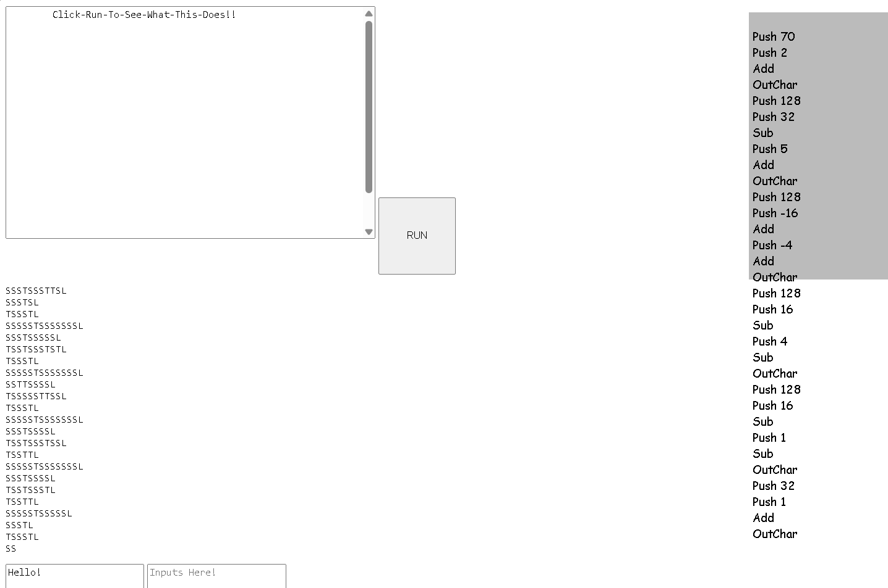

# WhiteSpace Compiler

A Simple Compiler for the WhiteSpace Esolang.

## Description

WhiteSpace is an esolang that functions based on just spaces, tabs and newlines / linefeeds (when you click enter). Mine works for the main parts that I could get working (Stack manipuation, arthimetic, Inputs/Outputs), Currently Flowcontrol isnt implemented, I tried and getting the labels and other parts to work how they are supposed to seemed quite complicated and would add alot of additional time to this project. I have not thoroughly tested all the implented functions so they may not work properly or at all. While writing code or if you paste code it will update the instruction set text on the right side of the screen and the code 'visualiser' below (s for space, t for tab and l for linefeed/newline).

### Screenshots

## Getting Started

### Recommendations 

* I recommened using other whitespace compilers first, for example https://vii5ard.github.io/whitespace/ is quite a good one as its visualiser is quite good because it highlights tabs and spaces
* I also recommend having for example https://en.wikipedia.org/wiki/Whitespace_%28programming_language%29 pulled up on another monitors or something so you can quickly look at the combination of whitespace characters for each instruction

### Executing program

* Enter the white space code into the code part, enter any neccesary Inputs, click run and see your outputs in output!

## Help

Sometimes the run button stops functioning, what I recommend doing is copying the code in the code box, refreshing the browser then putting the code back in.